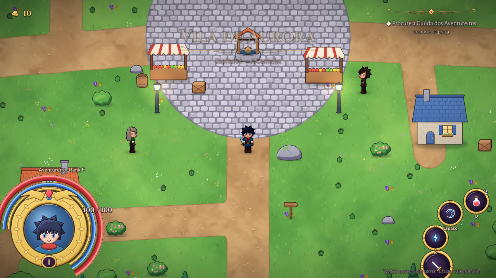
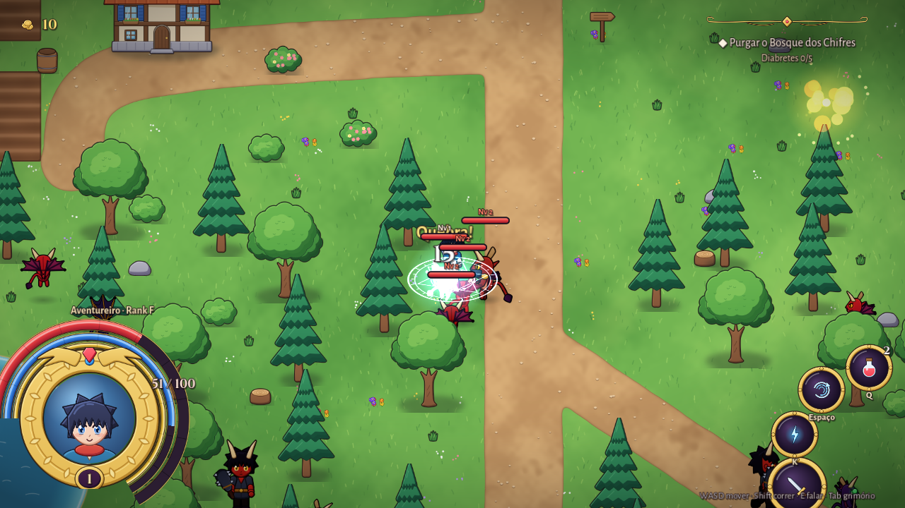

# Crônicas de Aetheria — A Centelha

RPG de ação 2D **isekai** em **Godot 4.3** (GDScript), com arte HD cartoon (nível *Happy Harvest*): sombreamento suave, contorno colorido, animações fluidas.
Toda a arte é gerada por código (Python + Cairo) em `tools/art_hd/` e importada pelo Godot (`godot/assets`).

> **Estado atual:** campanha completa dos Capítulos 1 a 10 (da Vila de Aurora até Malgrath, o Rei Demônio), com final e créditos. Rodando de ponta a ponta no Godot (screenshots de todas as regiões gerados em CI).
> Planejamento completo: [`docs/GAME_DESIGN.md`](docs/GAME_DESIGN.md) · Etapas e tarefas: [`docs/ROADMAP.md`](docs/ROADMAP.md)

> **Expansão em revisão (não na versão principal):** seis classes jogáveis com sprites HD próprios, retratos extraídos dos atlas e familiar original **Lince Astral**, com animações reais. [Ver produção e limites de validação](docs/CLASS_ART_IMPLEMENTATION.md) · [classes, atributos, armas e fraquezas](docs/CLASS_SYSTEM.md). [Prévias de sprites de verdade](docs/asset_catalog/previews/classes/) — não são prints do jogo.




## Jogar
- **Local:** instale o [Godot 4.3](https://godotengine.org/download), abra `godot/project.godot` e aperte F5 (sem licença, sem conta).
- **Sandbox/CI:** `tools/run.sh 90 -ciShots /tmp/shots` importa, roda sob Xvfb e salva screenshots. O workflow `.github/workflows/godot.yml` faz o mesmo a cada push e publica na branch `ci-shots`.

## Controles

**Novo Jogo:** selecione Guerreiro, Mago, Arqueiro, Paladino, Assassino ou Invocador. Os botões **J** e **K** executam a ação/skill específica da classe; Guerreiro não usa magia, Arqueiro somente arco, Mago somente feitiços, Assassino duas adagas e Invocador somente pets. Não há gasto de fôlego.

| Ação | Tecla |
|---|---|
| Mover / correr | WASD ou setas / Shift |
| Ataque exclusivo da classe (espada, magia, flecha, adagas ou comando ao pet) | J ou clique esquerdo |
| Habilidade exclusiva (espada, magia, rajada, cura, adagas ou invocação) | K ou clique direito |
| Rolar (invencível) | Espaço |
| Poção | Q |
| Falar | E |
| Grimório (bolsa, magias) | Tab |
| Salvar | F5 |
| Bestiário (gera o próximo demônio para testar) | F9 |

## Estrutura
```
godot/project.godot        projeto (autoloads: Util, Sheets, Data, Sfx, Story, Game)
godot/scripts/core         Util, Sheets (sprites+JSON), Anim, Sfx sintetizado
godot/scripts/game         Game, World, Player, Enemy, Npc, Companion, Projectile, Loot, Fx, Story, Data, CameraRig
godot/scripts/ui           Hud (arcos, orbes, diálogo, banners, barra de chefe, créditos), Grimoire
godot/data                 items / demons / recipes / story (JSON, fonte da verdade)
godot/assets               Sprites/, Maps/, Fonts/  (gerados por tools/art_hd)
tools/art_hd               pipeline de arte: core, humanoid, anims, demons, fx, env_objects, env_ground, maps
tools/run.sh               importa + roda no Xvfb (screenshots)
prototypes/                versões antigas (web, Godot 1, Unity C# completo), arquivadas
```

## Regerar a arte
```bash
pip install pycairo scipy numpy pillow
cd tools/art_hd
python3 build_hero.py && python3 build_npcs.py && python3 build_demons.py
python3 fx.py && python3 env_objects.py && python3 maps.py
```
