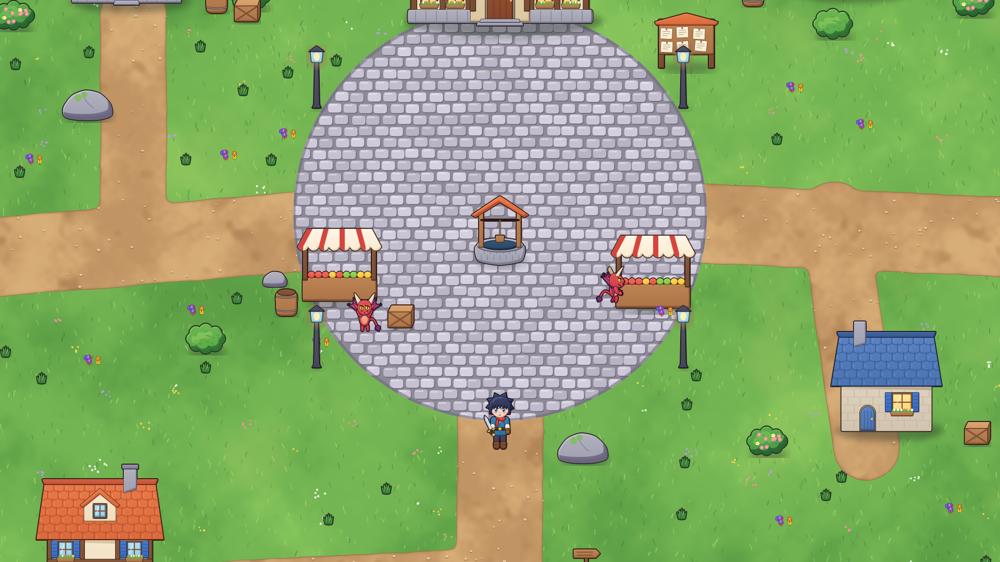

# Crônicas de Aetheria — A Centelha

RPG de ação 2D **isekai** em **Unity 2022.3 LTS**, com arte HD cartoon (nível *Happy Harvest*): sombreamento suave, contorno colorido, animações fluidas.
Toda a arte é gerada por código (Python + Cairo) em `tools/art_hd/` e carregada pela Unity via `Resources`.

> **Estado atual:** campanha completa dos Capítulos 1 a 10 (da Vila de Aurora até Malgrath, o Rei Demônio), com final e créditos. Falta validar tudo rodando na Unity (ver `docs/ROADMAP.md`).
> Planejamento completo: [`docs/GAME_DESIGN.md`](docs/GAME_DESIGN.md) · Etapas e tarefas: [`docs/ROADMAP.md`](docs/ROADMAP.md)



## Jogar
- **Local:** abra a pasta `unity/` na Unity 2022.3 LTS e aperte Play (a cena é criada por código).
- **Nuvem (GitHub Actions):** configure os segredos da licença — ver [`docs/UNITY_CI.md`](docs/UNITY_CI.md). Cada push monta o jogo para Linux, roda e publica screenshots na branch `ci-shots`.

## Controles
| Ação | Tecla |
|---|---|
| Mover / correr | WASD ou setas / Shift |
| Combo de espada (×3) | J ou clique esquerdo |
| Magia Centelha | K ou clique direito |
| Rolar (invencível) | Espaço |
| Poção | Q |
| Falar | E |
| Grimório (bolsa, magias) | Tab |
| Salvar | F5 |
| Bestiário (gera o próximo demônio para testar) | F9 |

## Estrutura
```
unity/Assets/Scripts/Core   Boot, Sheets (sprites+JSON), SpriteAnim, Util/YSort, Sfx sintetizado
unity/Assets/Scripts/Game   Game, World, Player, Enemy, Npc, Projectile, Loot, Fx, Story, Data, CameraRig
unity/Assets/Scripts/UI     Hud (arcos, orbes, diálogo cinematográfico, banners, números de dano)
unity/Assets/Editor         BuildScript (build headless) + importação de texturas
unity/Assets/Resources      Sprites/, Maps/, Fonts/, Shaders/  (gerados por tools/art_hd)
tools/art_hd                pipeline de arte: core, humanoid, anims, demons, fx, env_objects, env_ground, maps
tools/unity_check.sh        checagem de compilação C# sem Unity
prototypes/                 versões antigas (web e Godot), arquivadas
```

## Regerar a arte
```bash
pip install pycairo scipy numpy pillow
cd tools/art_hd
python3 build_hero.py && python3 build_npcs.py && python3 build_demons.py
python3 fx.py && python3 env_objects.py && python3 maps.py
```
